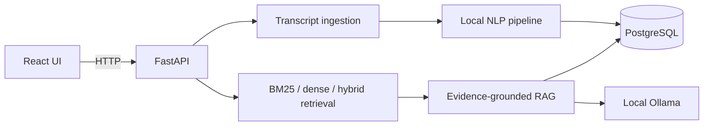

# Recall

Recall is a local-first meeting intelligence app for ingesting transcripts, extracting evidence-linked meeting records, and asking questions across meeting history.

## Run locally

Requirements: Python 3.11, Node 20+, Docker, and (optionally) Ollama with `qwen2.5:7b-instruct` pulled.

1. `docker compose up -d db`
2. In `backend`: `python -m venv .venv && source .venv/bin/activate && pip install -e . && alembic upgrade head && uvicorn app.main:app --reload`
3. In `frontend`: `npm install && npm run dev`
4. Open http://localhost:5173. API docs: http://localhost:8000/docs.

Copy `.env.example` to `.env`. Without Ollama, rule-based extraction and retrieval still work; LLM-generated summaries/chat are reported as unavailable and the pipeline preserves successful stages. Set `DATABASE_URL` to PostgreSQL; SQLite is supported for local tests and lightweight development.

## NLP / evaluation

Stages are isolated under `backend/app/nlp`, `knowledge`, and `rag`. Run `python eval/run_eval.py` for the deterministic baseline harness. Read [docs/ARCHITECTURE.md](docs/ARCHITECTURE.md), [docs/ASSUMPTIONS.md](docs/ASSUMPTIONS.md), and [docs/EVALUATION.md](docs/EVALUATION.md).

## macOS quickstart

Install Homebrew, Docker Desktop, Python 3.11, Node, and Ollama. Configure `.env` from `.env.example` without overwriting any existing local settings. Start Docker Desktop and Ollama, then run `make setup`, `make db-up`, `make migrate`, and `make models`. Start `make backend` and `make frontend` in separate terminals. `make seed` uploads the three sample transcripts; `make verify` also migrates, seeds, asks the six demo questions, and prints their cited sources. Swagger docs live at `/docs`.

## Screenshots

Screenshots can be added here after launching the local UI.

## Architecture

## NLP technique map

| Task | Technique | File | Purpose |
|---|---|---|---|
| Transcript segmentation | Regex speaker/timestamp patterns | `backend/app/ingestion/transcript_parser.py` | Evidence-aligned utterances |
| Summary | Ollama; optional BART/T5 | `backend/app/nlp/summarize.py` | Overview and key points |
| Entity extraction | spaCy NER + EntityRuler | `backend/app/nlp/ner.py` | Names, organizations, technology |
| Topics | KeyBERT with MMR | `backend/app/nlp/topics.py` | Diverse keyphrases |
| Actions | Rules + JSON LLM extraction | `backend/app/nlp/actions.py` | Tasks, ownership, deadlines |
| Decisions | Cue phrases + JSON extraction | `backend/app/nlp/decisions.py` | Evidence-linked choices |
| Search | BM25 and reciprocal rank fusion | `backend/app/knowledge/hybrid.py` | Cross-meeting retrieval |
| Answering | Source-grounded RAG | `backend/app/rag/answer.py` | Answers with transcript citations |

## Limitations

Optional NLP models require local downloads and sufficient memory. Rule fallbacks are measurable baselines and miss implicit tasks/entities. Full dense querying, learned-model evaluation, and decision supersession require optional model assets. Model outputs depend on the installed Ollama model and should be reviewed before academic reporting.
