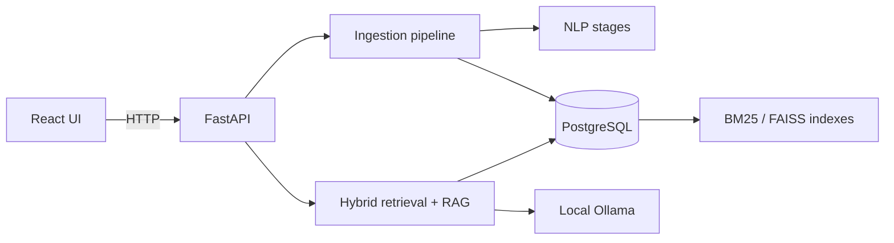
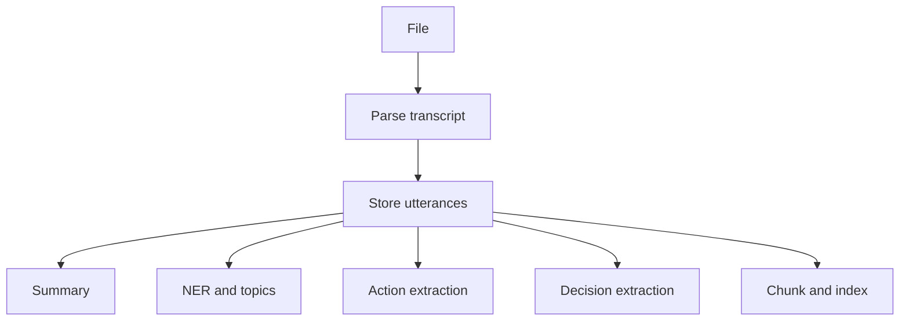
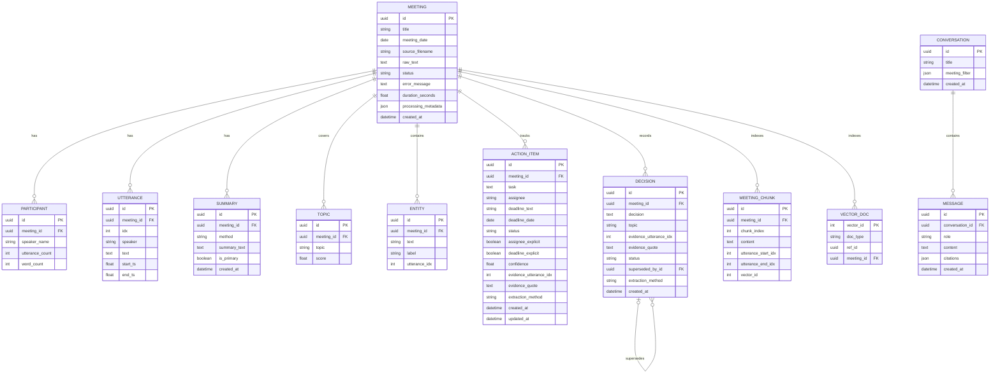

# Architecture

FastAPI routes validate requests and use SQLAlchemy models. Uploads save original text and parsed utterances before scheduling the independently guarded pipeline stages (summaries, NER/topics, actions/decisions, chunks/indexing). PostgreSQL is the source of truth; vector and lexical indexes are rebuildable derived state.

Retrieval supports dense, BM25, or reciprocal-rank fusion. Chat assembles evidence sources with utterance ranges and structured action/decision fields; citations are mapped back to meeting metadata and snippets before persistence. The `LLMClient` protocol isolates Ollama and keeps non-LLM fallbacks usable.

The academic components are separately measurable: `nlp/*` extraction, `knowledge/*` retrieval/indexing, `rag/*` query processing and citation assembly, and `eval/*` metrics/harness.
