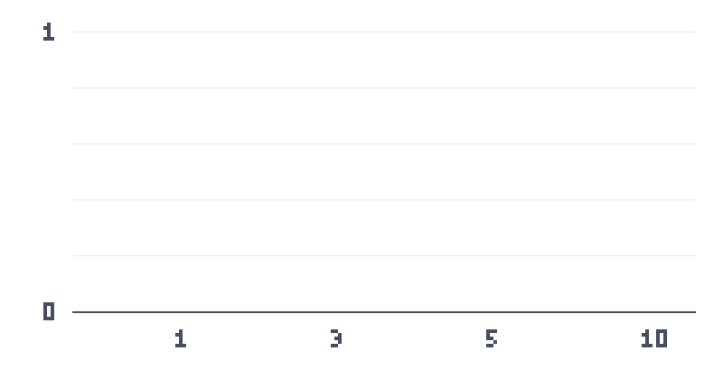

# Recall evaluation results

| Component | Status | Result / reason |
|---|---|---|
| actions · rules | not run | `"MiniLM weights unavailable"` |
| actions · llm | not run | `"Ollama/model and MiniLM required"` |
| decisions · rules | measured | `{"status": "measured", "precision": 0.23809523809523808, "recall": 0.8333333333333334, "f1": 0.37037037037037035}` |
| decisions · llm | not run | `"Ollama/model unavailable"` |
| retrieval · bm25 | measured | `{"recall@1": 0.08596491228070176, "recall@3": 0.16140350877192983, "recall@5": 0.24649122807017546, "recall@10": 0.36562500000000003, "mrr": 0.4528401444239802}` |
| retrieval · dense | not run | `"all-MiniLM-L6-v2 weights are not loaded; dense and hybrid results are not reported as lexical substitutes"` |
| retrieval · hybrid | not run | `"all-MiniLM-L6-v2 weights are not loaded; dense and hybrid results are not reported as lexical substitutes"` |
| qa | not run | `"Recall API is not running"` |
| ner | not run | `"spaCy package not installed"` |
| summarization | not run | `"transformers/torch are not installed"` |

Evaluation metadata: corpus is synthetic and hand-annotated; random seed is 17; embedding model is all-MiniLM-L6-v2; LLM is the configured local Ollama model; baseline summarizers are facebook/bart-large-cnn and google/flan-t5-base. Hardware and Python versions are recorded by the command output. Unavailable components are explicitly marked not run.
